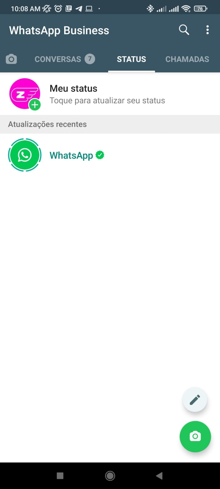
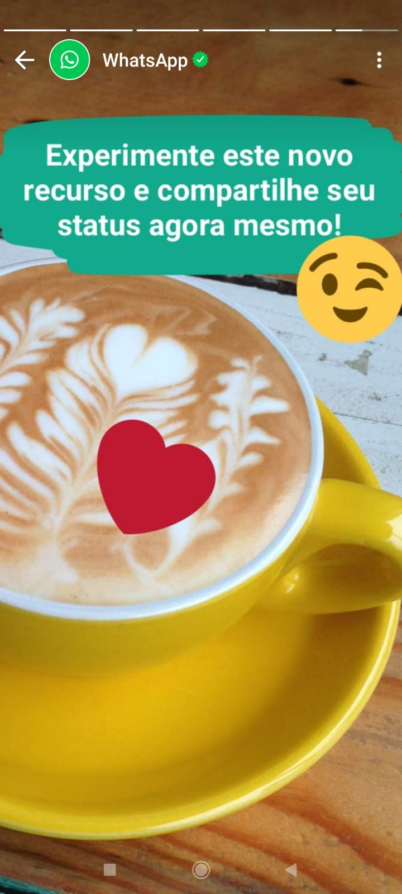
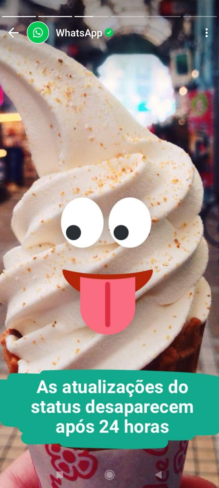

### Conceituação

Tópico difícil. Talvez por nunca ter utilizado o recurso eu nunca percebi muito valor nele, também não olho muito os status das pessoas talvez por utilizar o Whatsapp apenas para comunicação, mas enfim o recurso está disponível e cada um usa da forma que achar melhor. Se você como eu mal conhece este recurso ele fica "perdidinho" em uma aba entre Conversas e Chamadas, abaixo vou listar algumas imagens que explicam, segundo o próprio WhatsApp para que serve o recurso

